<div align="center">

# Email Phishing Detection & Automated Response
### n8n · Wazuh · Gmail API · Google Cloud Pub/Sub · VirusTotal · Telegram

**A practical SIEM + SOAR lab for detecting, analyzing, recording, and responding to suspicious email.**

</div>

---

## 1. Project Overview

This repository contains the **Email Phishing** scenario from a hands-on Security Orchestration, Automation and Response (SOAR) project.

The workflow monitors incoming Gmail messages, extracts URLs and attachments, analyzes indicators with VirusTotal, normalizes the results into JSON events, and forwards those events to Wazuh for SIEM visibility. Based on the analysis result, n8n applies the appropriate Gmail action and sends a Telegram notification to the administrator.

The implementation separates responsibilities:

- **n8n** orchestrates the workflow and performs response actions.
- **Wazuh** receives, decodes, stores, and classifies security events using custom rules.
- **VirusTotal** supplies URL and file reputation results.
- **Gmail and Telegram** are the response and notification channels.

> **Repository scope:** This repository focuses on the Email Phishing workflow. The separate SSH Brute Force / iptables scenario from the wider academic project is intentionally not represented as part of this repository's workflow.

## 2. Architecture

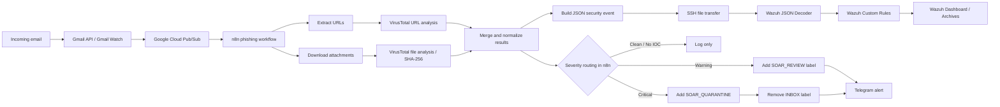

### Data flow

1. **Email intake:** Gmail API and the Gmail Watch / Pub/Sub notification path notify the workflow of mailbox changes.
2. **Content extraction:** n8n retrieves the message and checks for URLs and attachments.
3. **IOC analysis:** URLs are submitted for reputation analysis; attachments are analyzed using their SHA-256/file report.
4. **Event normalization:** Results are merged into a consistent JSON event containing message identifiers, sender/subject metadata, IOC details, and VirusTotal statistics.
5. **SIEM ingestion:** n8n converts the event to a file and transfers it to the Wazuh server over SSH. Wazuh decodes the JSON and applies the phishing custom rules.
6. **Automated response:** n8n routes the result to a clean, warning, or critical action path. Gmail labels and Telegram notifications provide visible response evidence.

## 3. Technology Stack

| Component | Role |
|---|---|
| n8n | SOAR workflow orchestration and response automation |
| Wazuh | SIEM event ingestion, JSON decoding, custom detection rules, archives and dashboard |
| Gmail API | Retrieve and manage email messages and labels |
| Gmail Watch / Google Cloud Pub/Sub | Mailbox-change notification path |
| VirusTotal API | URL and file reputation analysis |
| SSH | Secure file transfer from n8n to the Wazuh server |
| Telegram Bot | Administrator alerting |
| Ubuntu Server 24.04 | Wazuh server environment |
| Google Cloud VM | Cloud-hosted n8n environment |

## 4. Workflow Implementation

The main workflow is named `SOAR_Phishing_Email_Detection`.

### 4.1 URL analysis

- Extract URLs from the email content.
- Check whether the message contains one or more URLs.
- Split multiple URLs into individual analysis items.
- Query VirusTotal and collect `malicious`, `suspicious`, `harmless`, and `undetected` statistics.

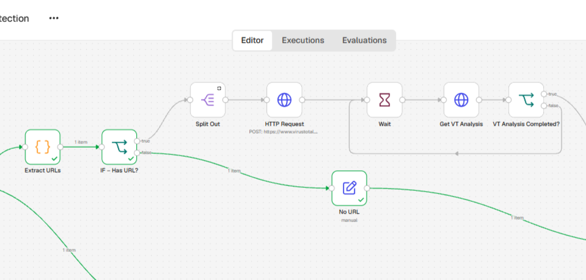

### 4.2 Attachment analysis

- Check whether the email contains attachments.
- Retrieve the attachment from Gmail.
- Calculate/use SHA-256 to identify the file.
- Submit or look up the file analysis in VirusTotal and retrieve the report.
- Normalize the file name, hash, verdict, severity, and engine statistics.

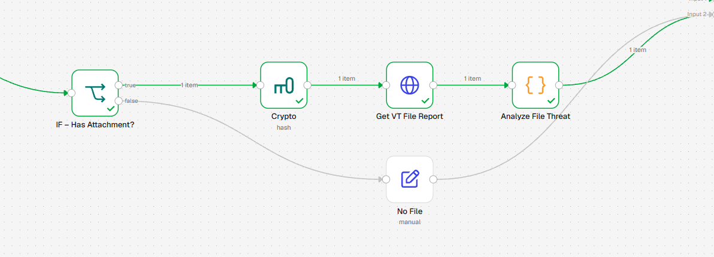

### 4.3 JSON event creation and Wazuh ingestion

The URL and file branches are merged before the workflow builds a normalized event. The event includes fields such as:

- `email_id` / message identifier
- `event_timestamp` and `event_type`
- sender and subject metadata
- URL/domain or file name and SHA-256
- VirusTotal statistics and verdict/severity

n8n converts the JSON event to a file, transfers it to the Wazuh host over SSH, and places it in the monitored SOAR log path. Wazuh's JSON decoder extracts the fields for searching and rule evaluation.

### 4.4 Wazuh custom rules

The repository includes the phishing rules file at `wazuh/rules/soar_phishing_rules.xml`.

| Rule ID | Purpose | Level |
|---:|---|---:|
| `100500` | URL analysis event received from n8n | 0 |
| `100501` | Malicious URL detected | 12 |
| `100502` | Suspicious URL detected | 8 |
| `100510` | File analysis event received from n8n | 0 |
| `100511` | Malicious file detected | 12 |
| `100512` | Suspicious file detected | 8 |
| `100513` | File requires manual review | 5 |

The screenshots below are taken from the Wazuh rule configuration used in the lab.

| URL rules | File rules |
|---|---|
| 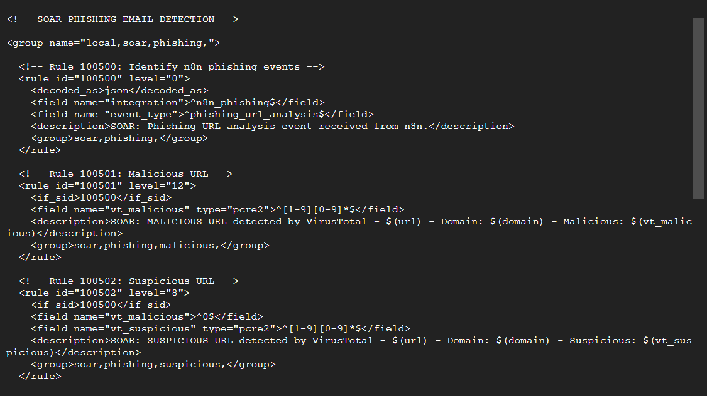 | 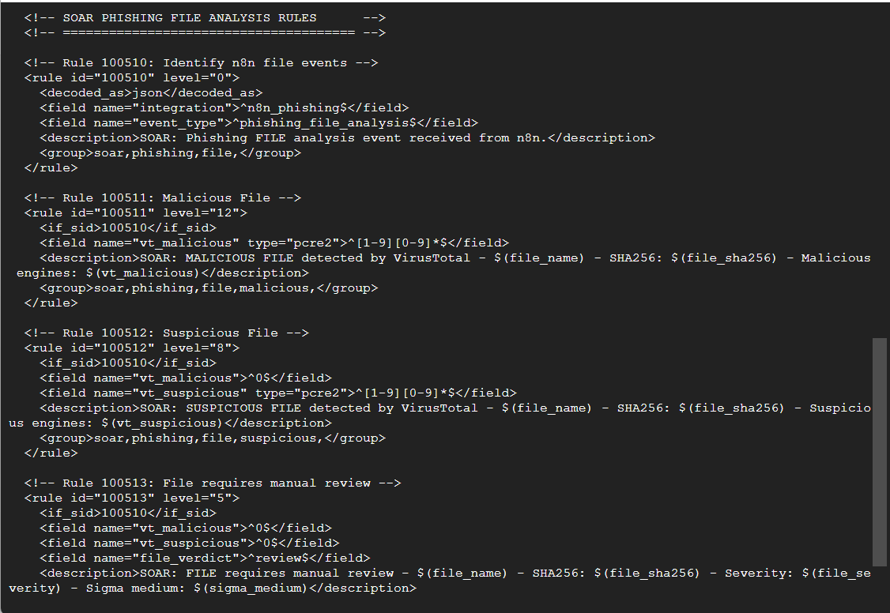 |

### 4.5 Automated response

| Classification | Gmail action | Notification |
|---|---|---|
| Clean / No IOC | Keep the email in Inbox; no quarantine label | No threat alert; event is still logged |
| Warning | Add `SOAR_REVIEW`; keep the email in Inbox | Send a warning to Telegram |
| Critical | Add `SOAR_QUARANTINE` and remove `INBOX` | Send a critical Telegram alert |

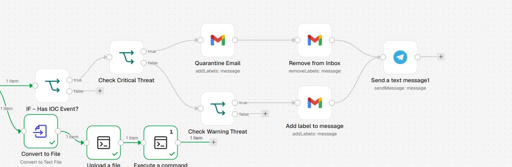

## 5. Evidence from the Lab

The following screenshots are extracted from the project report. Identifiers that are not needed for technical understanding (such as personal sender details, message IDs, and cloud project/host identifiers) have been masked before publication.

### Gmail Watch / Pub/Sub

The lab report documents the `gmail-soar-wazuh-sub` subscription used in the Gmail notification path.

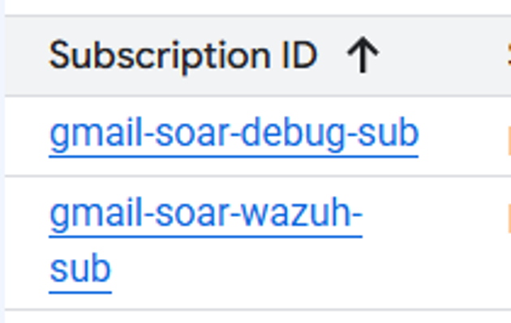

### n8n workflow execution

The workflow screenshots show the URL/file analysis paths and the downstream event-routing and response actions.

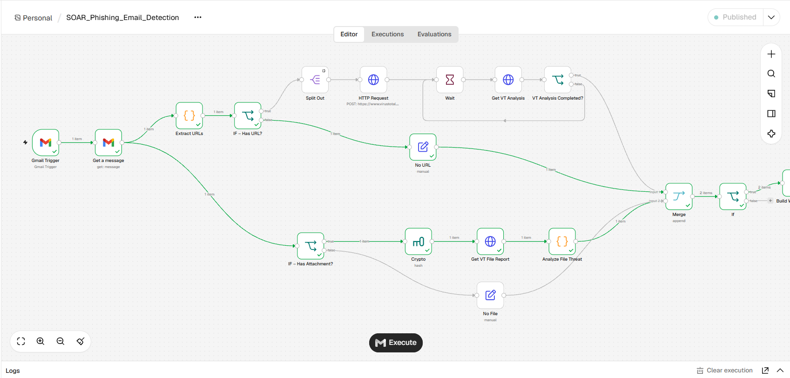

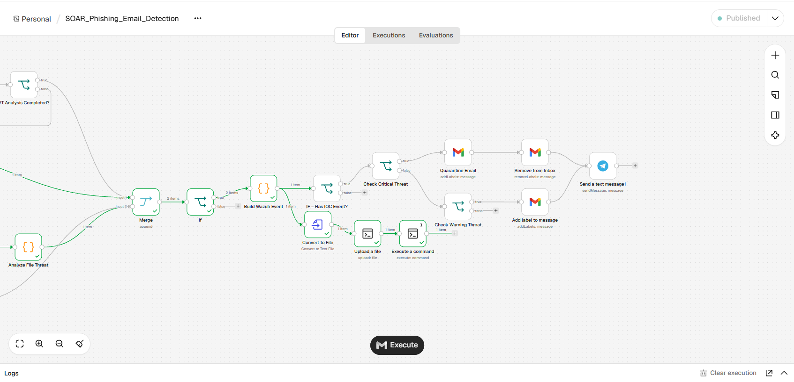

### Wazuh detection

The Wazuh dashboard screenshot shows a critical URL event classified with Rule `100501` at Level `12`.

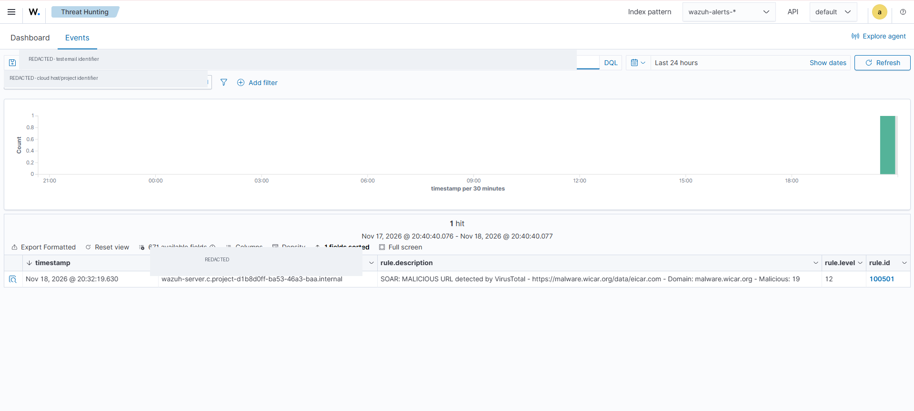

### Gmail and Telegram response evidence

The Gmail screenshot shows the `SOAR_QUARANTINE` label. The Telegram screenshot shows the critical verdict, VirusTotal counts, and automated response message.

| Gmail quarantine | Telegram critical alert |
|---|---|
| 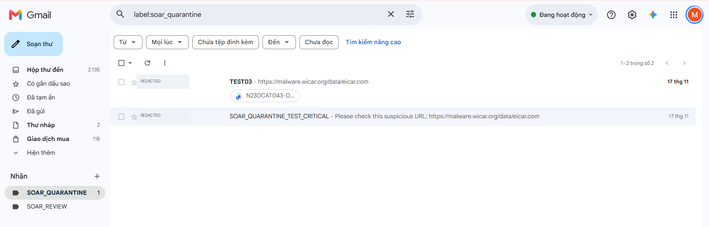 | 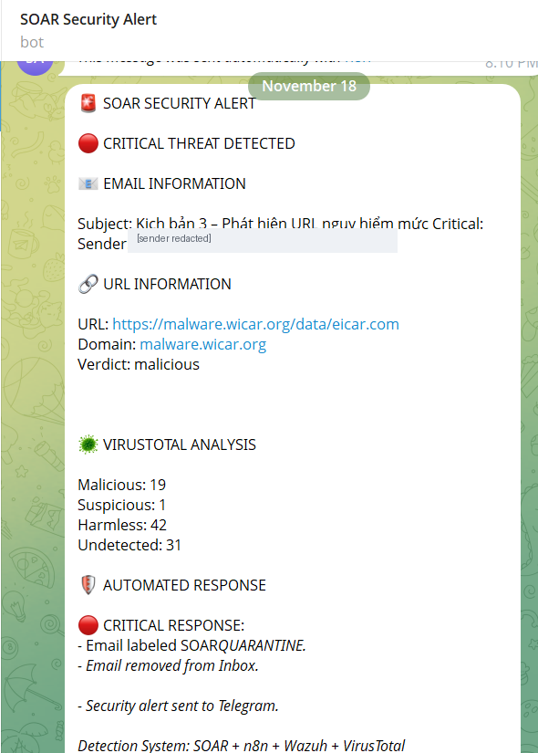 |

## 6. Test Scenarios and Results

Three email scenarios were documented in the lab report.

| Test case | Observed analysis | Observed response | Notes |
|---|---|---|---|
| Safe email | URL and file: `malicious = 0`, `suspicious = 0` | Event logged to Wazuh; no quarantine and no Telegram threat alert | Expected clean path |
| Attachment: `lala.pcap` | VirusTotal reported `malicious = 3`, `suspicious = 0` | Workflow was described as Warning; `SOAR_REVIEW` and Telegram warning were recorded | **Rule mismatch to resolve:** Wazuh evidence shows Rule `100511` (Level 12), while the workflow/report describes Warning. |
| Suspicious test URL | VirusTotal reported `malicious = 19`, `suspicious = 1` | Wazuh Rule `100501` (Level 12); Gmail `SOAR_QUARANTINE`, removal from Inbox, and Telegram critical alert | Critical response path demonstrated |

### Known validation item

The `lala.pcap` test is not presented as a fully consistent end-to-end classification. The report records `malicious = 3` and a Warning response, but the Wazuh evidence indicates Rule `100511`, which is defined as a malicious-file rule at Level 12. The n8n severity conditions, Wazuh rule conditions, and the event for the same `email_id` should be reconciled before describing this case as a validated Warning scenario.

The report also records one workflow execution duration of approximately **2.751 seconds** for the attachment test. This is a single execution duration, not a statistically validated end-to-end MTTR measurement.

## 7. Repository Structure

```text
Wazuh-n8n-Phishing-SOAR/
├── workflows/
│   └── soar_phishing_email_detection.json
├── wazuh/
│   └── rules/
│       └── soar_phishing_rules.xml
├── docs/
│   └── images/
│       ├── 01-pubsub-subscriptions.png
│       ├── 02-workflow-url-file-analysis.png
│       ├── 03-workflow-event-routing-response.png
│       ├── 04-url-analysis-branch.png
│       ├── 05-attachment-analysis-branch.png
│       ├── 06-wazuh-url-custom-rules.png
│       ├── 07-wazuh-file-custom-rules.png
│       ├── 08-automated-response-branch.png
│       ├── 09-wazuh-critical-alert.png
│       ├── 10-gmail-quarantine-label.png
│       └── 11-telegram-critical-alert.png
├── .gitattributes
├── .gitignore
└── README.md
```

## 8. Deployment Notes

This repository contains workflow and Wazuh rule artifacts, not a turnkey deployment. Before importing or enabling the workflow:

1. Install and configure n8n and Wazuh in an isolated lab environment.
2. Configure Gmail OAuth2 credentials and the Gmail Watch / Pub/Sub notification path.
3. Configure the VirusTotal API credential in n8n.
4. Configure SSH key-based access from n8n to the Wazuh server and create the monitored log directory with appropriate permissions.
5. Review the XML rule IDs and merge/deploy them according to the Wazuh manager's local rule configuration.
6. Import `workflows/soar_phishing_email_detection.json`, map credentials, verify node parameters, and publish the workflow.
7. Test with benign samples first. Validate each event using its message identifier across n8n, Wazuh, Gmail, and Telegram.

### Trigger-mode note

The report describes Gmail Watch / Pub/Sub as a near-real-time notification path. One captured Gmail Trigger settings screen shows a one-minute polling interval. For that reason, this project is described as **near-real-time**, not guaranteed instant push delivery. Confirm the active trigger configuration in the deployed workflow before making a stronger real-time claim.

## 9. Security Considerations

- Do not commit Gmail OAuth client secrets, access/refresh tokens, VirusTotal API keys, Telegram bot tokens, SSH private keys, or `.env` files.
- Use n8n credentials or a dedicated secret manager rather than hard-coding secrets in workflow nodes.
- Restrict SSH access to the required source host and destination path; use least-privilege accounts and file permissions.
- Keep test email accounts and sample files separate from production mailboxes.
- Use benign or controlled test indicators in an isolated lab. Do not send real malware to public scanning services unless authorized.
- Treat VirusTotal results as reputation signals, not absolute proof that an artifact is safe or malicious.
- Review quarantine rules carefully before enabling them on a production mailbox.

## 10. Limitations and Future Improvements

- Reconcile the Warning/Critical thresholds between n8n and Wazuh, especially the `lala.pcap` test case.
- Add idempotency/deduplication for repeated Gmail or Pub/Sub notifications.
- Test multiple URLs and attachments in one email, unsupported file types, VirusTotal rate limits, and analysis timeouts.
- Add explicit retry and error-handling paths for Gmail, Pub/Sub, VirusTotal, SSH, Wazuh, and Telegram failures.
- Record consistent timestamps across all components and collect multiple end-to-end samples before reporting MTTR.
- Add richer email analysis such as sender/domain reputation, header authentication checks, and URL normalization.

---

**Project type:** Academic Cybersecurity Lab · SIEM/SOAR Integration · Email Phishing Response
**Primary workflow:** `SOAR_Phishing_Email_Detection`
**Status:** Implemented and tested in a controlled lab; known classification inconsistency documented above.
